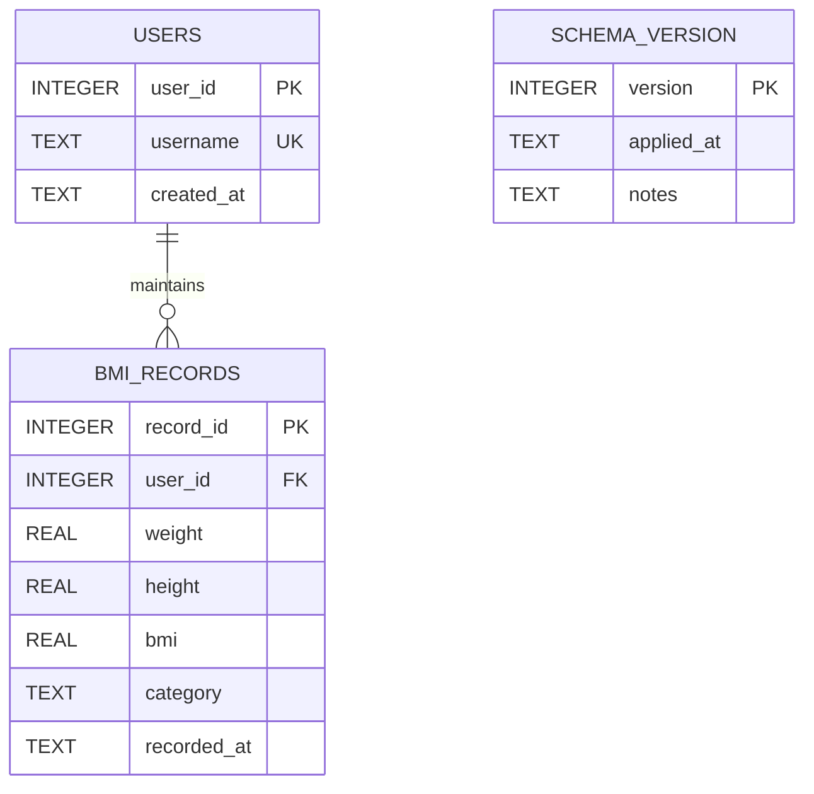

<div align="center">

<h1> BMI & WELLNESS TRACKER </h1>

<h3> A Minimalist Desktop Health Analytics Platform </h3>

<p>
Measure · Monitor · Understand · Improve
</p>


</div>

---


### A Minimalist Desktop Health Analytics Platform

**Measure · Monitor · Understand · Improve**

<br/>


<br/>

[](https://www.python.org/)
[](https://docs.python.org/3/library/tkinter.html)
[](https://www.sqlite.org/)
[](https://matplotlib.org/)
[]()
[]()

</div>

---

<div align="center">

## ◈ THE PROJECT

</div>

**BMI & Wellness Tracker** (`ArnavSharma_Task2`) is an offline-first Python desktop application designed to make personal health tracking simple, structured, and insightful.

The application combines accurate BMI calculations, WHO-based classification, multi-user profiles, persistent SQLite storage, historical measurement tracking, and Matplotlib-powered analytics.

Unlike conventional dashboard-heavy applications, the interface follows a **minimalist Scandinavian editorial design philosophy**, emphasizing whitespace, typography, floating statistics, and subtle visual hierarchy.

### Design Philosophy

| Light Mode | Dark Mode |
|:---:|:---:|
| Warm Beige `#F3EDE3` | Near Black `#111014` |
| Burnt Orange `#C8793C` | Soft Violet `#A987F5` |
| Charcoal `#29251F` | Luminous `#F2EFF7` |

---

## ◈ 01 — CORE FEATURES

<div align="center">

### Everything You Need to Track Your Wellness

</div>

| Feature | Description |
|:---|:---|
| BMI Calculator | Accurate BMI computation using weight and height |
| WHO Classification | Underweight, Normal, Overweight and Obese categories |
| Multi-User Profiles | Create, select, rename and delete user profiles |
| Measurement History | Track historical BMI and measurement records |
| Analytics Dashboard | Floating statistics and measurement comparisons |
| BMI Trend Charts | Matplotlib-powered historical visualizations |
| Date Filtering | 30 days, 90 days, yearly and all-time history |
| CSV Export | Export measurement records to spreadsheets |
| Database Backup | One-click SQLite backup and restoration |
| Dual Themes | Warm Beige / Burnt Orange and Black / Violet |
| High-DPI Support | Crisp rendering on high-resolution displays |
| Automated Testing | 50 automated tests covering application functionality |

---

## ◈ 02 — 3D SYSTEM ARCHITECTURE

<div align="center">

### Three-Layer Architectural Design

</div>

```text
                  ┌───────────────────────────────────┐
                 ╱       PRESENTATION LAYER          ╱│
                ╱───────────────────────────────────╱ │
               │                                     │ │
               │  OVERVIEW     CALCULATOR            │ │
               │  HISTORY      TRENDS                │ │
               │  PROFILES     SETTINGS              │ │
               │                                     │ │
               └───────────────────────────────────┘  │
                 │                                     │
                 ▼                                     │
                  ┌───────────────────────────────────┐
                 ╱      ORCHESTRATION LAYER          ╱│
                ╱───────────────────────────────────╱ │
               │                                     │ │
               │  BMIService                        │ │
               │  AppState                          │ │
               │  InputValidators                   │ │
               │  ExportService                     │ │
               │  BackupService                     │ │
               │                                     │ │
               └───────────────────────────────────┘  │
                 │                                     │
                 ▼                                     │
                  ┌───────────────────────────────────┐
                 ╱        PERSISTENCE LAYER          ╱│
                ╱───────────────────────────────────╱ │
               │                                     │ │
               │  SQLite3 Database                  │ │
               │  Users & BMI Records               │ │
               │  Referential Integrity             │ │
               │  Schema Versioning                 │ │
               │                                     │ │
               └───────────────────────────────────┘
```

---

## ◈ 03 — TECHNOLOGY STACK

<div align="center">


</div>

| Component | Technology | Purpose |
|:---|:---|:---|
| Language | Python 3.10–3.13 | Core application |
| GUI | Tkinter + ttk | Desktop interface |
| Database | SQLite3 | Persistent local storage |
| Visualization | Matplotlib | BMI trend analytics |
| GUI Charts | FigureCanvasTkAgg | Matplotlib integration |
| Data Export | Python CSV | RFC-4180 compliant exports |
| Testing | pytest 8.3+ | Automated testing |
| Packaging | PyInstaller | Standalone executable |
| High-DPI | Windows ctypes | Display scaling |

---

## ◈ 04 — BMI MATHEMATICAL MODEL

BMI is calculated using the Quetelet Index:

\[
BMI = \frac{Weight\ (kg)}{Height\ (m)^2}
\]

### WHO Classification

| BMI Range | Classification |
|:---:|:---|
| Below 18.5 | Underweight |
| 18.5 – 24.9 | Normal |
| 25.0 – 29.9 | Overweight |
| 30.0 and above | Obese |

### Healthy Weight Calculation

For a given height:

\[
W_{min}=18.5\times h^2
\]

\[
W_{max}=24.9\times h^2
\]

**Precision safeguard:** Classification uses the unrounded BMI value to prevent incorrect categorization caused by display rounding.

> Note: BMI is a screening measure, not a standalone medical diagnosis.

---

## ◈ 05 — DATABASE ARCHITECTURE

The application uses SQLite3 with relational integrity and persistent local storage.



### Database Engineering

- ACID-compliant transactions.
- Foreign key enforcement.
- Parameterized SQL queries.
- Cascading profile deletion.
- Schema versioning and migration support.
- Indexed measurement records.
- Transactional backup and restoration.

---

## ◈ 06 — PROJECT STRUCTURE

```text
ArnavSharma_Task2/
│
├── main.py
├── config.py
├── build_executable.py
├── requirements.txt
├── README.md
├── LICENSE
│
├── data/
│   ├── bmi_records.db
│   └── app.log
│
├── assets/
│   └── screenshots/
│
├── modules/
│   ├── bmi.py
│   ├── database.py
│   ├── validation.py
│   ├── services.py
│   └── gui.py
│
└── tests/
    ├── test_bmi.py
    ├── test_validation.py
    ├── test_database.py
    ├── test_services.py
    └── test_gui.py
```

*Directory structure illustrates the major application components; adjust it if your actual repository uses different filenames.*

---

## ◈ 07 — INSTALLATION

### Prerequisites

- Windows 10 / Windows 11
- Python 3.10, 3.11, 3.12 or 3.13
- pip package manager

### Step 1 — Clone Repository

```powershell
git clone https://github.com/ArnavSharma-IND/ArnavSharma_Task2.git

cd ArnavSharma_Task2
```

### Step 2 — Create Virtual Environment

```powershell
python -m venv venv
```

### Step 3 — Activate Environment

```powershell
.\venv\Scripts\Activate.ps1
```

If execution policies restrict activation:

```powershell
Set-ExecutionPolicy -Scope Process -ExecutionPolicy Bypass
```

### Step 4 — Install Dependencies

```powershell
pip install --upgrade pip

pip install -r requirements.txt
```

---

## ◈ 08 — LAUNCH APPLICATION

Start the desktop application:

```powershell
python main.py
```

### First Launch

1. Initializes the local SQLite database.
2. Creates the default `Primary User` profile.
3. Loads the Warm Beige and Burnt Orange theme.
4. Initializes the desktop interface.
5. Enables measurement tracking and analytics.

---

## ◈ 09 — TESTING & QUALITY ASSURANCE

<div align="center">


### Automated Testing Matrix

</div>

| Test Suite | Tests | Coverage |
|:---|:---:|:---|
| BMI Calculation | 13 | Formula, precision, WHO boundaries |
| Input Validation | 17 | Weight, height, usernames, dates |
| Database | 11 | CRUD, foreign keys, transactions |
| Services | 6 | Profiles, CSV, backups |
| GUI | 3 | Window lifecycle, tabs, themes |
| **TOTAL** | **50** | **100% Passed** |

Run the test suite:

```powershell
python -m pytest tests/ -v
```

---

## ◈ 10 — STANDALONE WINDOWS EXECUTABLE

Package the application into a standalone Windows executable.

### Automated Build

```powershell
python build_executable.py
```

### Manual PyInstaller Build

```powershell
pyinstaller --noconfirm --onedir --windowed --name "BMI_Wellness_Tracker" --add-data "assets;assets" main.py
```

Output:

```text
dist/
└── BMI_Wellness_Tracker/
    └── BMI_Wellness_Tracker.exe
```

---

## ◈ 11 — PRIVACY & DATA SOVEREIGNTY

Privacy is a core architectural principle.

- **100% Offline Operation:** No external APIs or cloud dependencies.
- **Local Data Ownership:** All health records remain on the local machine.
- **SQL Injection Protection:** Parameterized SQL queries.
- **Sanitized Logging:** Sensitive health information is excluded from operational logs.
- **Backup & Recovery:** Local database backup and restoration.
- **User Control:** Export or delete profile data.

---

## ◈ 12 — FUTURE ENHANCEMENTS

| Enhancement | Status |
|:---|:---:|
| Advanced Health Analytics | Planned |
| Custom Measurement Goals | Planned |
| Extended Wellness Reports | Planned |
| Additional Data Visualization | Planned |

---

## ◈ 13 — SCREENSHOTS

<div align="center">

### Application Interface

<!-- Replace these placeholders with actual screenshots -->


**LIGHT MODE — Warm Beige & Burnt Orange**

<br/><br/>


**DARK MODE — Near Black & Soft Violet**

</div>

---

## ◈ 14 — DEVELOPER

<div align="center">


### Arnav Sharma

**Computer Science & Artificial Intelligence**

<br/>

[](https://github.com/ArnavSharma-IND)

[](https://www.linkedin.com/in/arnav-sharma-dev/)

<br/>

**Project:** ArnavSharma_Task2

**Program:** Oasis Infobyte Python Programming Internship

**Task:** BMI & Wellness Tracker

**License:** MIT

<br/>

*Engineered with precision. Designed with simplicity.*


</div>
