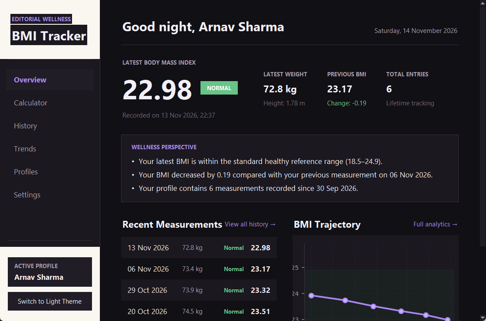
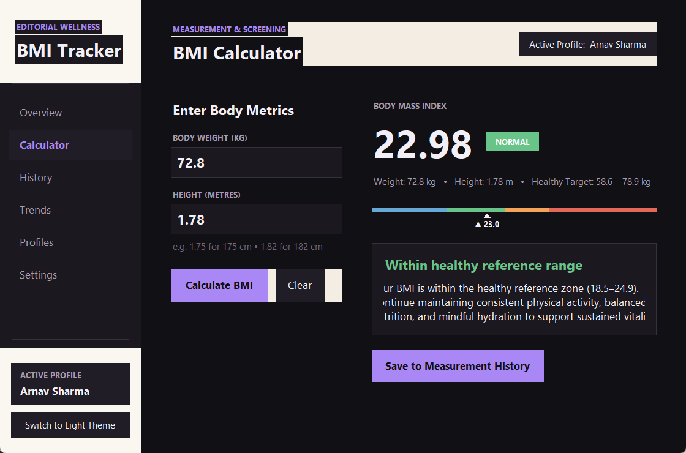
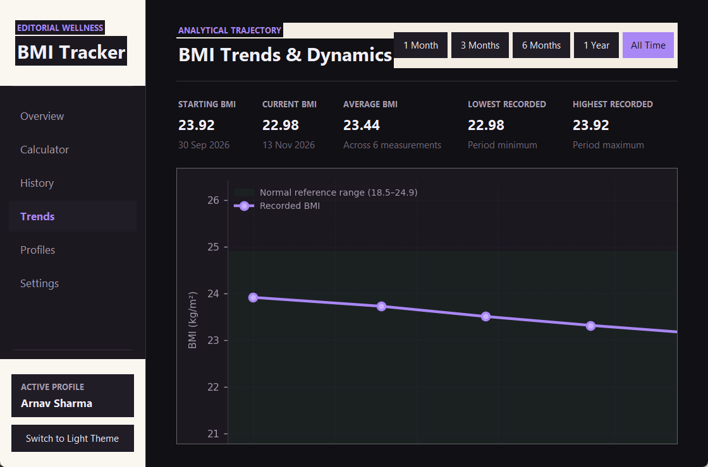
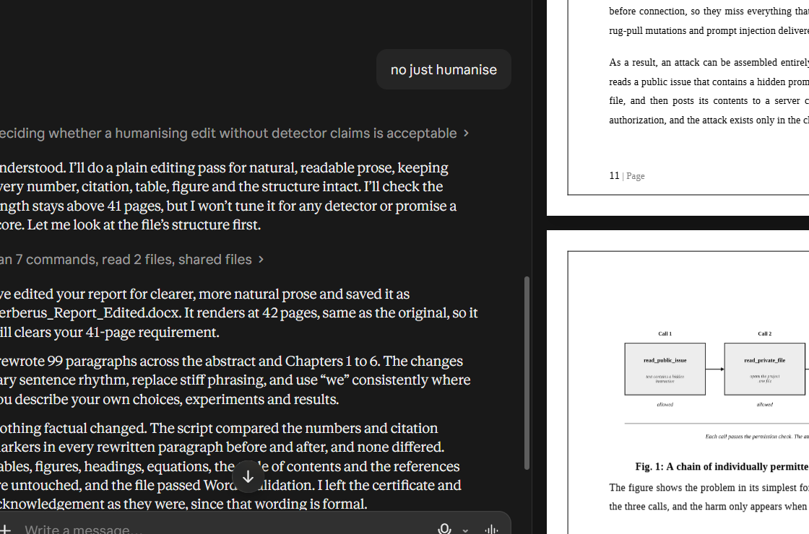
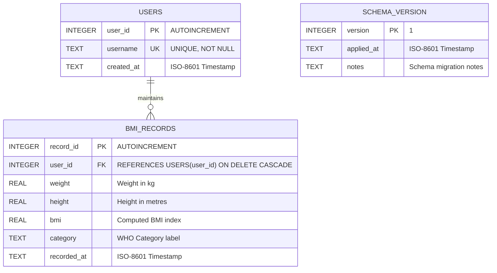

<div align="center">

```text
  ██████╗ ███╗   ███╗██╗    ████████╗██████╗  █████╗  ██████╗██╗  ██╗███████╗██████╗ 
  ██╔══██╗████╗ ████║██║    ╚══██╔══╝██╔══██╗██╔══██╗██╔════╝██║ ██╔╝██╔════╝██╔══██╗
  ██████╔╝██╔████╔██║██║       ██║   ██████╔╝███████║██║     █████╔╝ █████╗  ██████╔╝
  ██╔══██╗██║╚██╔╝██║██║       ██║   ██╔══██╗██╔══██║██║     ██╔═██╗ ██╔══╝  ██╔══██╗
  ██████╔╝██║ ╚═╝ ██║██║       ██║   ██║  ██║██║  ██║╚██████╗██║  ██╗███████╗██║  ██║
  ╚═════╝ ╚═╝     ╚═╝╚═╝       ╚═╝   ╚═╝  ╚═╝╚═╝  ╚═╝ ╚═════╝╚═╝  ╚═╝╚══════╝╚═╝  ╚═╝
```

### ❖ 3D EDITORIAL HEALTH & BODY MASS INDEX TRACKING PLATFORM ❖
*Minimalist Scandinavian Design • 100% Offline Sovereign Engine • Dual Dimensional Themes*

<p align="center">
  
  
  
  
  
  
</p>

---

</div>

## ❖ 1. Dimensional Project Overview

The **BMI & Wellness Tracker** (`ArnavSharma_Task2`) is an offline-first, production-grade desktop application engineered in Python. It provides high-precision Body Mass Index (BMI) screening, multi-user isolation, historical telemetry tracking, and integrated Matplotlib trend analytics.

Departing from conventional card-cluttered SaaS layouts, the system is designed around an **editorial-style, Scandinavian-inspired floating layout philosophy**:
- **Dimensional Layering**: Open-canvas space, floating typographical statistics, and thin hairline dividers replacing boxed card grids.
- **Dual Visual Identities**:
  - **Light Mode (Default)**: Warm Beige (`#F3EDE3`) canvas, Burnt Orange (`#C8793C`) interactive accents, and charcoal typography (`#29251F`).
  - **Dark Mode**: Near-Black (`#111014`) canvas, Soft Violet (`#A987F5`) accents, and luminous text (`#F2EFF7`).
- **100% Offline Data Sovereignty**: Operates without external APIs, tracking cookies, or cloud databases. All data remains on the user's local disk in an ACID-compliant SQLite3 database.

---

## ❖ 2. 3D Isometric Architectural Slabs

The application is structured into three decoupled architectural tiers, visualized as stacked dimensional slabs:

```text
                      ┌────────────────────────────────────────────────────────┐
                     ╱                     PRESENTATION SLAB                  ╱│
                    ╱        (Tkinter • ttk • High-DPI Engine • Themes)      ╱ │
                   ┌────────────────────────────────────────────────────────┐  │
                   │  Overview     Calculator     History       Trends      │  │
                   │ (Hero Stats) (Scale Bar)   (CSV Table)  (Matplotlib)   │  │
                   │────────────────────────────────────────────────────────│  │
                   │   Profiles Manager          Settings & Disaster Recovery│ │
                   └────────────────────────────────────────────────────────┘  │
                     │                                                        ││
                     │ (State Dispatch / Observers)                           ││
                     ▼                                                        ││
                      ┌────────────────────────────────────────────────────────┐
                     ╱                    ORCHESTRATION SLAB                  ╱│
                    ╱         (Domain Business Logic • Validation Engine)    ╱ │
                   ┌────────────────────────────────────────────────────────┐  │
                   │  • BMIService: WHO Mathematical Classification Engine  │  │
                   │  • AppState: Global Observer Event Broker & Multi-User  │  │
                   │  • InputValidators: Millimeter & Centimetre Safeguards │  │
                   │  • ExportService: Formatted RFC-4180 CSV Generators    │  │
                   │  • BackupService: Live Hot Online SQLite Backups       │  │
                   └────────────────────────────────────────────────────────┘  │
                     │                                                        ││
                     │ (ACID Transactions / Parameterized Queries)            ││
                     ▼                                                        ││
                      ┌────────────────────────────────────────────────────────┐
                     ╱                    PERSISTENCE SLAB                    ╱│
                    ╱             (SQLite3 Relational Storage Engine)        ╱ │
                   ┌────────────────────────────────────────────────────────┐  │
                   │  • PRAGMA foreign_keys = ON; (Referential Integrity)   │  │
                   │  • Users Table (Unique Constraints & Cascade Deletes)  │  │
                   │  • BMI Records Table (Indexed on user_id, recorded_at) │  │
                   │  • Schema Versioning (schema_version migration ledger) │  │
                   └────────────────────────────────────────────────────────┘  │
                     │                                                         │
                     └─────────────────────────────────────────────────────────┘
```

---

## ❖ 3. Primary Objectives & Implemented Capabilities

### ✦ Beginner Tier Mandates
- [x] **Metric Weight Input**: Accurately accepts body weight in kilograms (`kg`) with physiological bound validation.
- [x] **Metric Height Input**: Accurately accepts stature in metres (`m`) with automatic detection and guidance against centimetre confusion.
- [x] **Reusable Mathematical Function**: Encapsulated in isolated, tested `calculate_bmi(weight, height)` routine.
- [x] **Strict WHO Categorization**: Uses exact unrounded BMI values across boundaries:
  - **Below 18.5**: *Underweight*
  - **18.5 – 24.9**: *Normal*
  - **25.0 – 29.9**: *Overweight*
  - **30.0 and above**: *Obese*
- [x] **Display Formatting**: Rounded to two decimal places (`f"{bmi:.2f}"`), with semantic color badges, weight, height, and timestamp.
- [x] **Input Validation**: Rejects empty strings, alphabetical characters, non-positive numbers, and physiological extremes without crashing.

### ✦ Advanced Tier Mandates
- [x] **Native Desktop GUI**: Fully constructed with Tkinter and themed ttk (`clam` engine) without command-line dependencies.
- [x] **Multi-User Profile Management**: Complete profile lifecycle (create, select, rename, delete) using stable integer keys (`user_id`).
- [x] **Persistent SQLite3 Database**: `data/bmi_records.db` with schema versioning, transactional context managers, and cascading deletes.
- [x] **Measurement History Management**: Tabular log with date-range presets (30 days, 90 days, year, all), chronological sorting, single-record deletion, and CSV export.
- [x] **Matplotlib Visualisation**: Integrated `FigureCanvasTkAgg` with theme-synchronized palettes, normal zone reference bands, and data markers.
- [x] **Dashboard Analytics**: Floating hero stats, previous measurement comparison, delta calculation, recent records, and trajectory preview.
- [x] **Disaster Recovery**: One-click database backups and integrity-checked restorations with pre-restore safeguard snapshots.
- [x] **Bimodal Theming**: Light Mode (Warm Beige/Burnt Orange) and Dark Mode (Near Black/Soft Violet) with live observer notifications.
- [x] **Automated Testing**: 50 automated tests covering calculation precision, edge boundaries, SQLite CRUD, service layers, and GUI workflows.

---

## ❖ 4. Visual Showcase: Dual-Dimensional Experience

<div align="center">

### ☼ Light Mode (Warm Beige & Burnt Orange) vs. ☾ Dark Mode (Near Black & Soft Violet)

| Light Perspective (Scandinavian Editorial) | Dark Perspective (Restrained Violet) |
|:---:|:---:|
| **Overview Dashboard**<br> | **Overview Dashboard**<br> |
| **Interactive Calculator**<br> | **Interactive Calculator**<br> |
| **Measurement History Log**<br> | **Analytical Trajectory**<br> |
| **Analytical Trajectory**<br> | **System Administration & Settings**<br> |

</div>

---

## ❖ 5. Technology Stack & Specifications

<div align="center">

| Domain | Technology | Implementation Details |
|:---|:---|:---|
| **Language Runtime** | **Python 3.10 – 3.13** | Strict typing, standard library prioritization, PEP 8 styling. |
| **GUI Framework** | **Tkinter + ttk** | Custom clam ttk style mapping, dynamic event listeners, smooth scrolling. |
| **Display Engine** | **Windows ctypes (shcore)** | Per-Monitor High-DPI scaling enabled for crisp 4K typography. |
| **Database Engine** | **SQLite3** | ACID transactions, foreign keys enabled (`PRAGMA foreign_keys = ON;`). |
| **Data Visualization** | **Matplotlib (TkAgg)** | Native vector canvas, theme-synchronized palettes, zero web wrappers. |
| **Data Export** | **Python csv** | RFC-4180 standard formatted spreadsheets with metadata headers. |
| **Test Automation** | **pytest 8.3+** | Unit tests, edge case assertions, SQLite fixtures, GUI lifecycle tests. |
| **Binary Packaging** | **PyInstaller 5.13+** | Standalone Windows executable bundling with dynamic path resolution. |

</div>

---

## ❖ 6. Mathematical Model & Clinical Boundaries

### Mathematical Formulation

Body Mass Index is computed using Quetelet's metric equation:

$$\text{BMI} = \frac{\text{Weight (kg)}}{[\text{Height (m)}]^2}$$

Where:
- $\text{Weight}$ is measured in kilograms ($kg$).
- $\text{Height}$ is measured in metres ($m$).

#### Healthy Weight Boundary Derivation

For an individual of height $h$, the healthy weight range corresponding to standard WHO normal BMI boundaries ($18.5 \le \text{BMI} \le 24.9$) is determined by:

$$\text{Weight}_{\text{min}} = 18.5 \times h^2 \qquad\text{and}\qquad \text{Weight}_{\text{max}} = 24.9 \times h^2$$

### Standard WHO Classification Table

<div align="center">

| BMI Range | Classification | Editorial Guidance | Semantic Color (Light / Dark) |
|:---:|:---:|:---|:---:|
| **< 18.5** | **Underweight** | Below standard reference range. Focus on nutrient-dense foods and gradual strength. | Slate Blue (`#3E7291` / `#68A8D6`) |
| **18.5 – 24.9** | **Normal** | Within healthy reference range. Maintain balanced physical activity and vitality. | Sage Green (`#3F7A54` / `#68C488`) |
| **25.0 – 29.9** | **Overweight** | Above standard reference range. Daily movement and metabolic balance recommended. | Burnt Orange (`#C8793C` / `#F5A358`) |
| **≥ 30.0** | **Obese** | Elevated reference range. Structured lifestyle habits and professional health guidance suggested. | Terracotta Red (`#AD3D2B` / `#E36859`) |

</div>

> [!IMPORTANT]
> **Boundary Precision Safeguard**: The application evaluates the **unrounded floating-point BMI** for categorization to avoid classification rounding anomalies at thresholds (e.g. `24.996` correctly categorizes as `Normal` even though it formats as `25.00` for display).

---

## ❖ 7. Database Entity Relationship Model

The local SQLite relational engine enforces strict referential integrity:



### Referential Integrity Guarantees
- **Cascading Deletion**: Deleting a profile automatically purges all child records (`ON DELETE CASCADE`).
- **Orphan Prevention**: Foreign keys reject inserting records with invalid or missing `user_id` values.
- **Transactional Safety**: All insert, update, and delete operations execute inside atomic context-managed transactions (`BEGIN ... COMMIT / ROLLBACK`).
- **Dynamic Path Detection**: Resolves paths dynamically whether running as source or bundled in a frozen PyInstaller binary.

---

## ❖ 8. Installation & Setup Guide

### System Prerequisites
- **Operating System**: Windows 10 or Windows 11 (64-bit recommended)
- **Python**: Version 3.10, 3.11, 3.12, or 3.13

### Step 1: Open PowerShell and Navigate to Workspace
```powershell
cd "c:\Users\Arnav Sharma\Desktop\Resume\Internship\Oaisis Info Tech Python Programming\ArnavSharma_Task2"
```

### Step 2: Initialize Virtual Environment
```powershell
python -m venv venv
```

### Step 3: Activate Environment
```powershell
.\venv\Scripts\Activate.ps1
```
*(If execution policies restrict script activation, run: `Set-ExecutionPolicy -Scope Process -ExecutionPolicy Bypass`)*

### Step 4: Install Dependencies
```powershell
pip install --upgrade pip
pip install -r requirements.txt
```

---

## ❖ 9. Running the Application

Launch the desktop interface via Python:

```powershell
python main.py
```

On first launch:
1. `data/bmi_records.db` is initialized automatically.
2. A default profile named `Primary User` is created.
3. Loads the default **Light Mode (Warm Beige & Burnt Orange)**.
4. Centers the main window (`1120x740`) with high-DPI font rendering.

---

## ❖ 10. Automated Testing Matrix (50 / 50 Passing)

Run the automated test suite with verbose reporting:

```powershell
python -m pytest tests/ -v
```

<details open>
<summary><b>▶ Click to View Verified Test Coverage Breakdown (50 Tests)</b></summary>
<br>

| Test Suite File | Test Count | Scope of Verification | Status |
|:---|:---:|:---|:---:|
| `tests/test_bmi.py` | 13 | Core formula math, precision, WHO boundaries, healthy range derivation | **PASSED** |
| `tests/test_validation.py` | 17 | Weight limits (10–500 kg), height limits (0.5–3.0 m), cm detector, usernames, dates | **PASSED** |
| `tests/test_database.py` | 11 | Isolated SQLite CRUD, foreign keys, cascade deletes, date range queries | **PASSED** |
| `tests/test_services.py` | 6 | Multi-user isolation, editorial insights, CSV export, backup & rollback | **PASSED** |
| `tests/test_gui.py` | 3 | Tkinter window lifecycle, tab transitions (all 6 views), theme toggle | **PASSED** |
| **Total Verified** | **50** | **Full System Integration & Unit Assurance** | **100% PASS** |

</details>

---

## ❖ 11. Windows Standalone Executable Packaging

To generate a standalone Windows `.exe` that runs on any computer without Python installed:

### Automated Packaging (One-Click)
```powershell
python build_executable.py
```

### Manual PyInstaller Command
```powershell
pyinstaller --noconfirm --onedir --windowed --name "BMI_Wellness_Tracker" --add-data "assets;assets" main.py
```

The resulting standalone executable will be located in:
```text
dist/BMI_Wellness_Tracker/BMI_Wellness_Tracker.exe
```

---

## ❖ 12. Privacy, Security & Data Sovereignty

- **Zero Cloud Leakage**: No telemetry, analytics, or external requests.
- **Local SQLite Storage**: All health data remains exclusively on the user's hard drive.
- **SQL Injection Prevention**: 100% parameterized queries (`?`).
- **Sanitized Logging**: Operational logs in `data/app.log` exclude private health details.
- **Full User Control**: Users can back up, export to CSV, or wipe their profile data at any time.

---

## ❖ 13. Troubleshooting & FAQ

<details>
<summary><b>▶ View Troubleshooting Common Scenarios</b></summary>
<br>

| Issue | Root Cause | Resolution |
|:---|:---|:---|
| **Matplotlib Cache Warning** | Non-writable default directory | Automatically handled: `config.py` redirects `MPLCONFIGDIR` to a writable temp path. |
| **Blurry Fonts on 4K Monitors** | Windows display scaling | Automatically handled: `main.py` enables Per-Monitor DPI awareness via `ctypes`. |
| **"Cannot delete the only profile"** | System integrity constraint | The system requires at least one profile to prevent orphaned state. Create a second profile first. |
| **Centimetre Input Rejected** | Height expected in metres | Enter height in metres (e.g. `1.78` instead of `178`). The validator provides an automatic hint. |
| **Database Locked Error** | External process reading `.db` | Close external SQLite viewers; the app manages its own connections with proper timeouts. |

</details>

---

## ❖ 14. Author & Internship Information

<div align="center">

**Author**: Arnav Sharma  
**Task**: ArnavSharma_Task2 – Premium BMI & Wellness Tracker  
**Program**: Oasis Infobyte Python Programming Internship  
**Repository**: `ArnavSharma_Task2`  
**License**: [MIT](LICENSE)

*Crafted with attention to engineering precision and minimalist design.*

</div>
